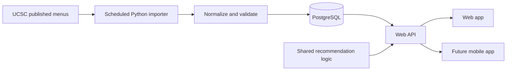

# Architecture plan

**Status: proposed; no services implemented.**

## Data flow

During the first milestone, curated fixtures can support the interface while live source access is investigated. Clearly distinguish fixture-backed screens from live menus.

## Component boundaries

- `apps/web`: browser interface and Next.js API endpoints. Keep business calculations outside presentation components.
- `services/menu-importer`: retrieve, parse, validate, and store published menu data. Run independently from visitor requests.
- `packages/domain`: shared TypeScript types and pure serving/nutrition utilities once implemented.
- `packages/recommendations`: pure plate-generation and scoring logic. No UI, direct database access, or network requests.
- `database`: versioned schema changes and synthetic development data.
- `apps/mobile`: future client using the same API and appropriate shared logic. Web components are not assumed to be portable to native screens.

## Proposed entities

| Entity | Responsibility |
| --- | --- |
| Dining hall | Source location identifier and display name |
| Menu / offering | Hall, campus-local date, meal period, food reference, and availability context |
| Food / recipe version | Source identity, name, serving size and unit, nutrient fields, and published dietary labels |
| Import run | Start/end times, source, result, validation failures, and observed coverage |
| User profile / goals | Editable targets and preferences when accounts are introduced |
| Meal log entry | Consumption date/time, serving quantity, and a nutrition snapshot |
| Favorite | User or local preference linked to a food identity |
| Alert delivery | Future subscription, dated appearance, channel, and deduplication key |

These are design concepts, not a final SQL schema.

## Import requirements

Investigate source structure, identifiers, nutrition coverage, access guidance, and available feeds before deciding the final collection approach. Use bounded requests and caching. Keep raw captures locally for debugging; commit only small reviewed fixtures where appropriate.

Validate before publishing an import. An upstream error or empty response must not erase known data or appear as a genuinely empty menu. Retain the last successful snapshot with its original menu date and show freshness accurately. Make repeat imports idempotent. Record failures for investigation.

## User data and credentials

Never expose database write credentials in browser code. When accounts are added, enforce user ownership of profiles, meal logs, favorites, and subscriptions. Add tests for access across two different users. Use local environment files for credentials; commit a placeholder-only example when the required variables are known.

## Hosting

The web app, database, and importer have separate runtime needs. Select scheduling and hosting after importer duration and refresh needs are known. Free-tier limits and commercial-use terms must be checked before deployment. Mobile clients will reuse the API; store submission is a later milestone.
